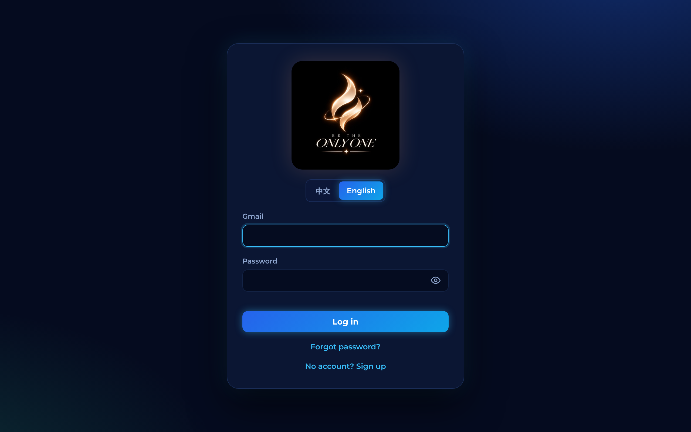
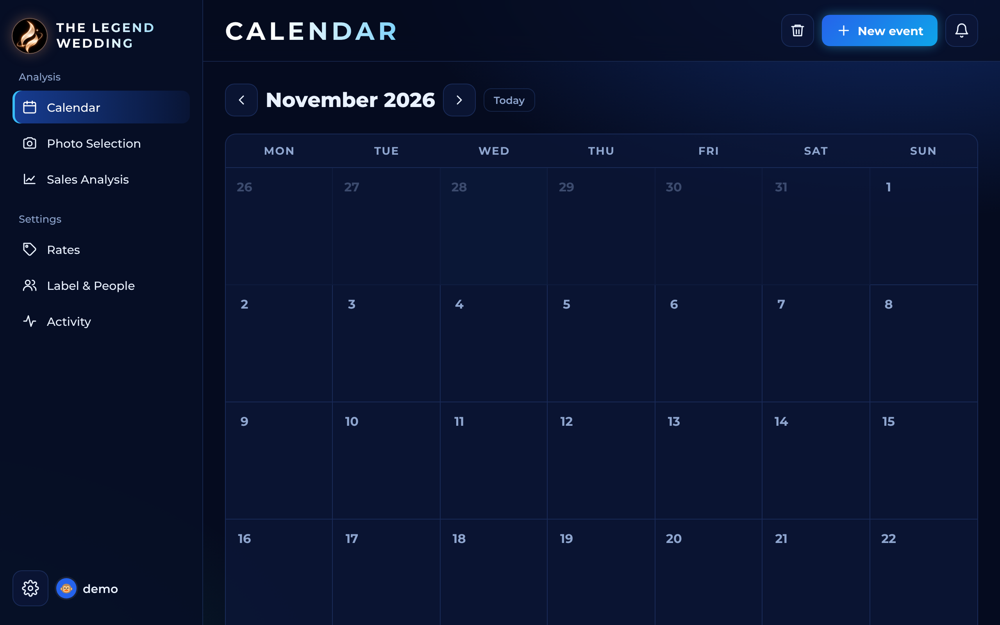
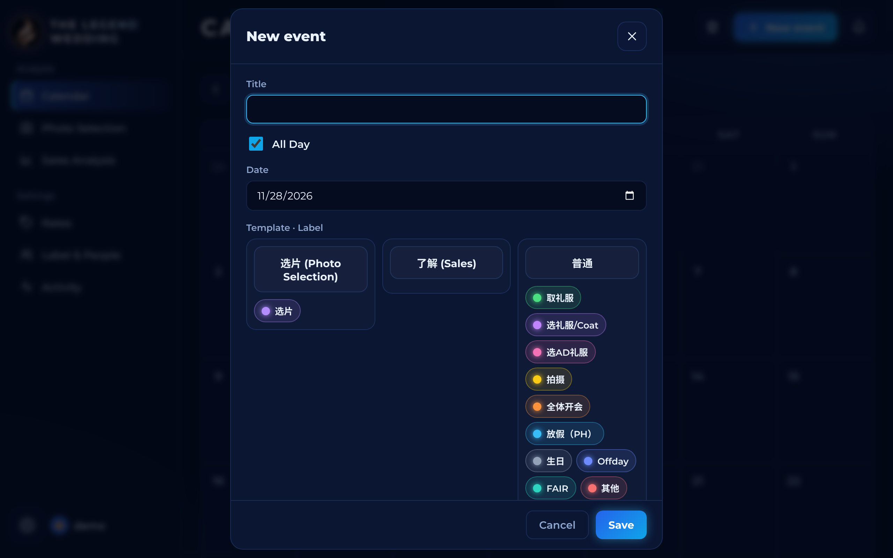
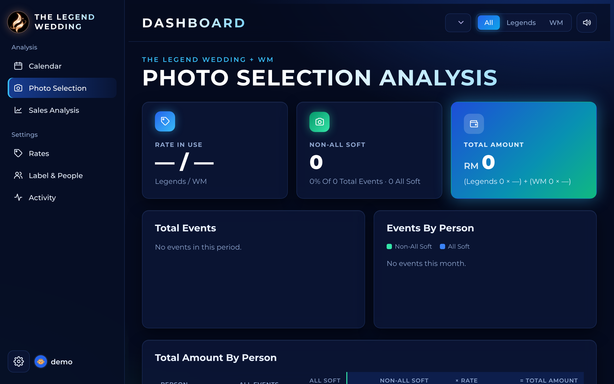
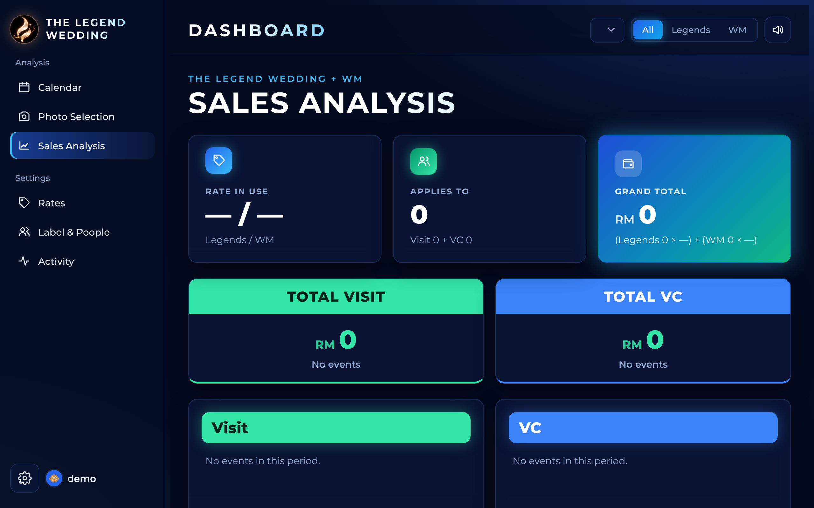
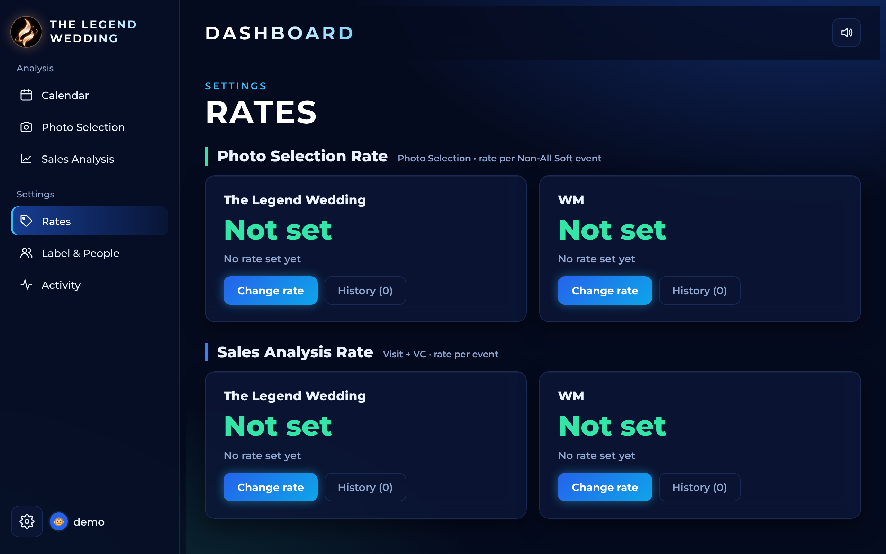
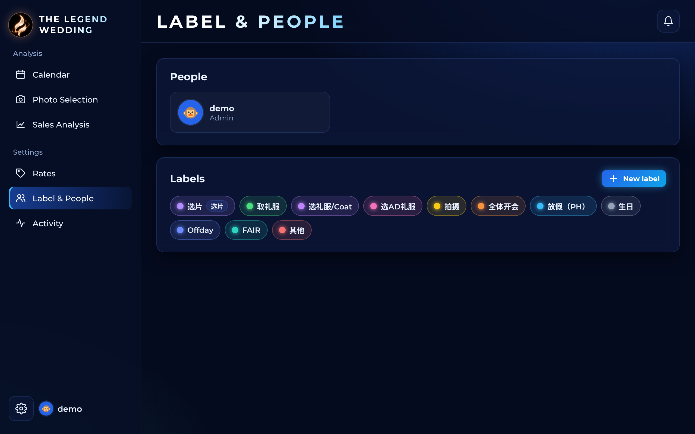
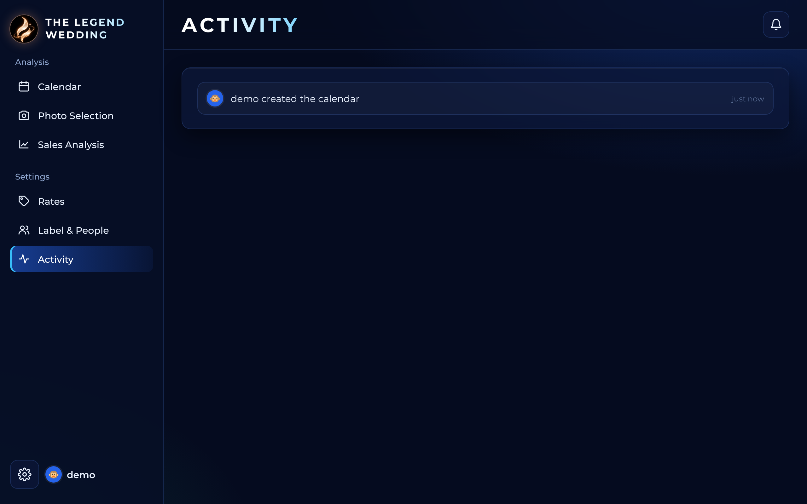
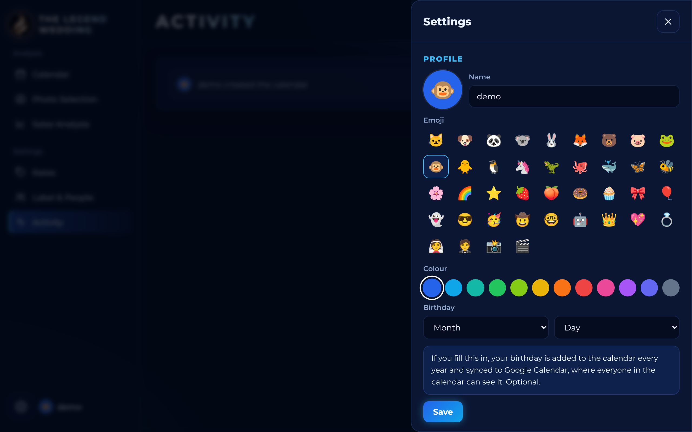
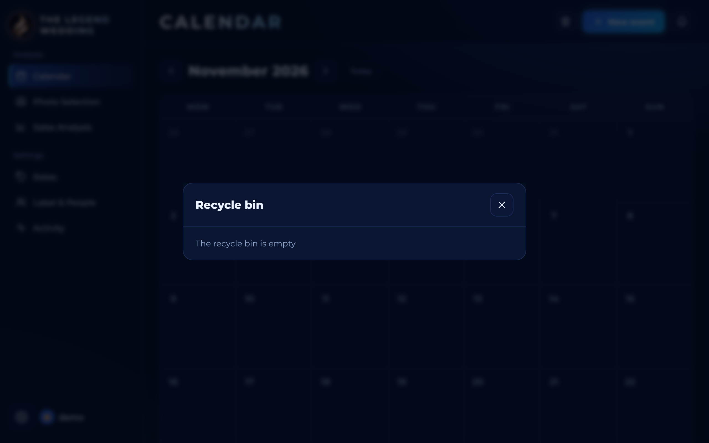

# 📅 The Legend Calendar — Schedule Mode

A shared calendar and studio dashboard for **The Legend Wedding** and **WM**: one place for the team's bookings, photo-selection and sales numbers, rates, labels and activity. Two-way Google Calendar sync, invite links, and it installs on a phone like an app (PWA). English · 中文.

**Live app:** https://tris35.github.io/Shared-calendar-schedule-mode/

> 共享日历 + 工作室数据面板：团队的行程、选片和销售分析、价格设定、标签和人员、活动记录都在一个地方。与 Google 日历双向同步，可以用邀请连结一起编辑，手机可以「加到主画面」当 App 用。

---

## 📸 Screenshots

_Taken from an empty demo account — no real customer data._

| Log in | 📅 Calendar |
|:---:|:---:|
|  |  |
| **➕ New event** | **📷 Photo Selection** |
|  |  |
| **📈 Sales Analysis** | **🏷️ Rates** |
|  |  |
| **🎨 Label & People** | **🕘 Activity** |
|  |  |
| **⚙️ Settings** | **🗑️ Recycle bin** |
|  |  |

---

## ✨ Tabs

### 📅 Calendar
- Month view with Monday–Sunday weeks; tap a day for its timeline, tap an event for details
- **New event** with title, all-day or timed, date, and **templates** (选片 Photo Selection, 了解 Sales, 普通) that pre-fill the label
- Comments, photos and a full change history on each event; deleting moves it to the **Recycle bin**

### 📷 Photo Selection (dashboard)
- Filter by brand: **All · Legends · WM**
- Rate in use, Non-All Soft count, **Total amount (RM)**
- Total events, events by person, and total amount by person for the chosen period

### 📈 Sales Analysis (dashboard)
- Rate in use, how many events it applies to, **Grand total (RM)**
- **Total Visit** and **Total VC**, each with its own event list

### 🏷️ Rates
- Photo Selection rate and Sales Analysis rate, set separately for **The Legend Wedding** and **WM**
- **Change rate** with a full **History** of past rates

### 🎨 Label & People
- Everyone in the calendar with their emoji avatar and role
- Colour labels (选片, 取礼服, 选礼服/Coat, 选AD礼服, 拍摄, 全体开会, 放假 (PH), 生日, Offday, FAIR, 其他); add your own with **New label**

### 🕘 Activity
- A live feed of who created, changed or deleted what, with a 🔔 notification bell

### ⚙️ Settings
- Profile: name, emoji, colour and an optional birthday (added to the calendar every year)
- Google Calendar connection, invite links (**Can edit** / **View only**), admins, language

### 🗑️ Recycle bin
- Deleted events stay here and can be restored

### 🔄 Google Calendar (two-way)
- Each person connects their own Gmail; choose which calendars to sync
- Changes either way appear within seconds; failed syncs retry automatically
- The app only asks Google for **Calendar** permission

---

## 🧱 How it's built

| Part | Where | Service (free plans) |
|---|---|---|
| Website / app | `docs/` | **GitHub Pages** |
| Backend API | `supabase/functions/api/` (one Edge Function, Deno + TypeScript) | **Supabase** Edge Functions |
| Database | `supabase/migrations/` | **Supabase** Postgres (+ Storage for photos) |
| Timers | `pg_cron` | Google pull every 30 min, keep-warm every 1 min |

```
docs/                       App (published by GitHub Pages)
  config.js                 ← backend URL (Supabase functions URL)
  index.html  v2.js  v2.css  dashboard.html
  sw.js  manifest.json  icons/      installable app
supabase/
  migrations/               tables, security, timers
  functions/api/            backend (handles every /api/... route)
test/                       local test server and tests
```

Backend URL: `https://<project>.supabase.co/functions/v1/api/...`

---

## 🚀 Deploy

1. Create a project on **supabase.com** (free).
2. Install the Supabase CLI, then:
   ```bash
   supabase link --project-ref <project-id>
   supabase db push --remote
   supabase functions deploy api --use-api --no-verify-jwt
   supabase secrets set APP_URL=https://<github-user>.github.io/<repo-name>
   ```
3. In `docs/config.js`, set `apiBase` to `https://<project-id>.supabase.co/functions/v1`.
4. GitHub → **Settings → Pages** → Deploy from a branch → `main` / `/docs` (the repo must be public on the free plan).
5. Open the app and **sign up** the first account.

### Function secrets (Supabase → Edge Functions → Secrets)
| Secret | Purpose |
|---|---|
| `APP_URL` | App address, e.g. `https://tris35.github.io/Shared-calendar-schedule-mode` |
| `ADMIN_EMAILS` | Permanent admin Gmail(s), comma-separated (more admins can be added inside the app) |
| `APP_TIMEZONE` | Default `Asia/Kuala_Lumpur` |
| `GOOGLE_CLIENT_ID`, `GOOGLE_CLIENT_SECRET` | Google Calendar sync (optional) |
| `GMAIL_USER`, `GMAIL_APP_PASSWORD` | Gmail that sends forgot-password codes (a Google **App Password**, needs 2-Step Verification) |

### Google Calendar sync
Create an OAuth client (Web application) in Google Cloud with redirect URI
`https://<project-id>.supabase.co/functions/v1/api/google/callback`, enable the Google Calendar API, and **publish** the consent screen (otherwise access expires after 7 days). Add the client ID and secret as function secrets.

### Install as an app
- **iPhone:** Safari → Share → **Add to Home Screen**
- **Android:** Chrome → ⋮ → **Install app**

---

## 🧪 Local test
Needs Deno and a local Postgres:
```bash
createdb cal
for f in supabase/migrations/*.sql; do case $f in *0100_supabase*|*0500_keep_warm*) ;; *) psql -d cal -f "$f";; esac; done
TEST_DB_URL=postgres://localhost/cal LOCAL_PHOTO_DIR=/tmp/photos API_BASE=http://localhost:8081 APP_URL=http://localhost:8080 \
  deno run -A --config supabase/functions/api/deno.json test/local-api.ts
```
Then serve `docs/` with any static server (set `apiBase` in `config.js` to `http://localhost:8081`). `…0100_supabase.sql` and `…0500_keep_warm.sql` are Supabase-only.
