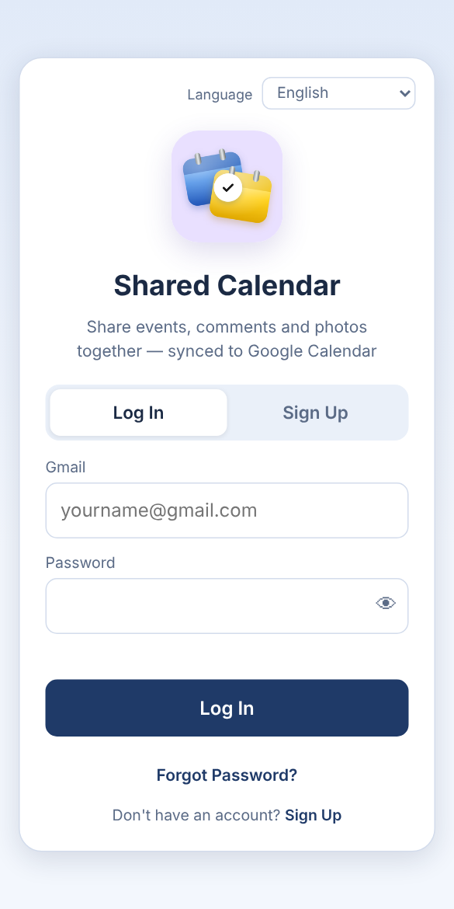
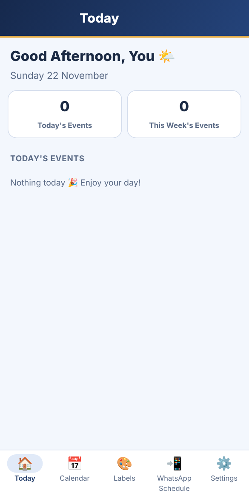
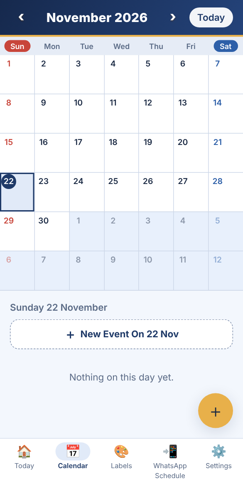
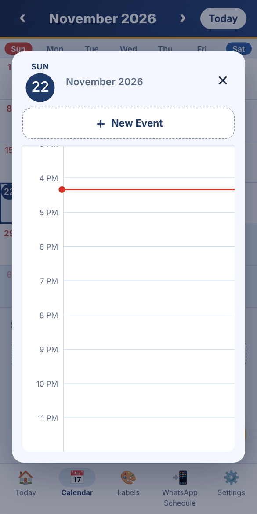
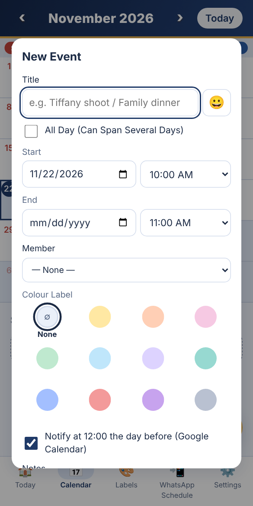
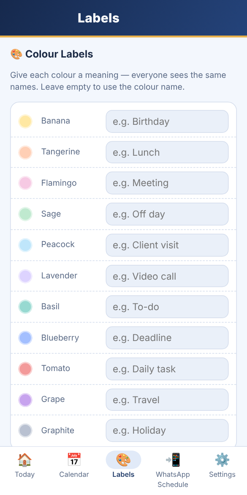
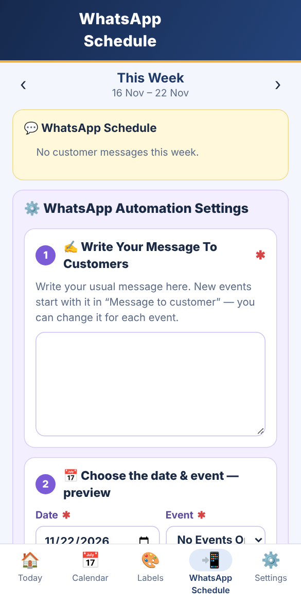
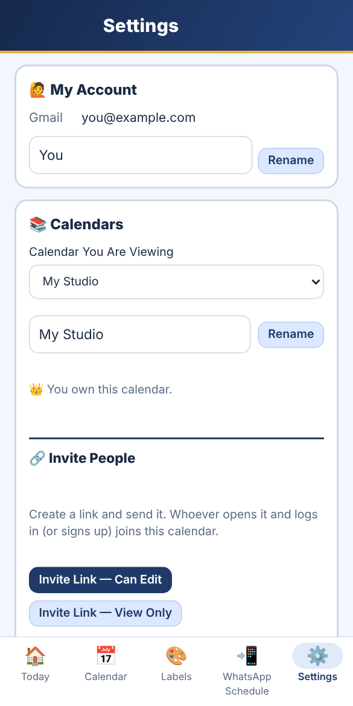
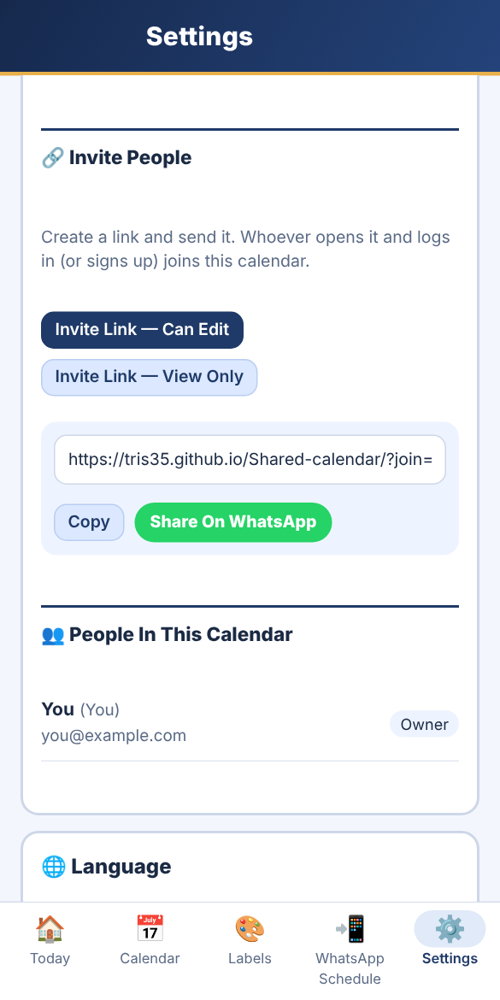
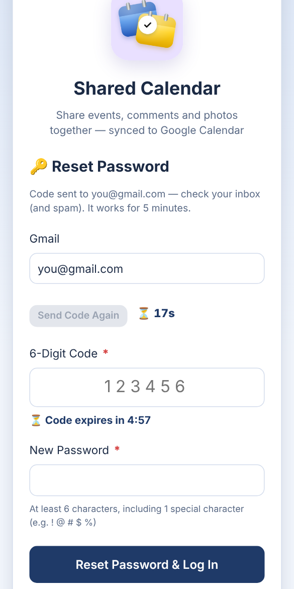

# 📅 Shared Calendar — Schedule Mode

> **这是 [Shared Calendar](https://github.com/tris35/Shared-calendar) 的复制版本，多了「自动提醒（Schedule Mode）」：**
> 行程标题开头是 booking number（例：`6961 选礼服 …`、`WM0186 取AD`）→ 自动从 **Google 通讯录**找到名字里有这个号码的联络人（例：`6961`、`6961 Ivy`、`WM 1902`）→ 前一天 **下午 2 点**用 WhatsApp 发**中文提醒**。
>
> - 设定在 **WhatsApp 排程** 页签最上面（管理员才看得到）：开关、**预览模式**（默认开，只列出会发给谁，不会真的发）、发送时间、提醒内容
> - 提醒内容可以用 `{name}` `{date}` `{time}` `{booking}`；默认：「您好{name}，提醒您明天 {date} {time} 的预约（编号 {booking}）。如需更改时间，请联络我们。谢谢！」
> - 自动提醒**不会附上行程标题**（标题里有员工名字等内部资料）
> - 找不到电话、或同一个号码有多个联络人 → 不发送，在清单里标出来给员工检查
> - 员工自己在行程里填的电话不会被通讯录覆盖
> - 连接 Google 时多要一个「查看联络人（只读）」权限 → Google Cloud 要启用 **People API**
> - Meta 商家验证通过前，保持**预览模式**；通过后把 `WHATSAPP_TOKEN`（永久 token）、`WHATSAPP_PHONE_NUMBER_ID`、`WHATSAPP_TEMPLATE`、`WHATSAPP_TEMPLATE_LANG=zh_CN` 加进 Supabase Secrets，再关掉预览模式
> - 测试：`deno run -A --config supabase/functions/api/deno.json test/schedule-mode.test.ts`（需要 `TEST_DB_URL`）


A shared calendar app for a small studio, team or family — every account gets its own private calendar, invite links to edit together, checklists, two-way Google Calendar sync and WhatsApp reminders to customers. Works in any browser and installs on a phone like an app (PWA). English · 简体中文 · 繁體中文 · Bahasa Melayu.

**Live app:** https://tris35.github.io/Shared-calendar-schedule-mode/

> 共享日历：给工作室、团队或家人用的行程 App —— 每个帐号自己的日历、邀请连结一起编辑、清单、Google 日历双向同步、WhatsApp 自动提醒客户、忘记密码寄验证码到 Gmail。手机可以「加到主画面」当 App 用。

---

## 📸 Screenshots

| Log in | 🏠 Today | 📅 Calendar |
|:---:|:---:|:---:|
|  |  |  |
| **Day timeline** | **New event** | **🎨 Labels & people** |
|  |  |  |
| **📲 WhatsApp Schedule** | **⚙️ Settings** | **🔗 Invite people** |
|  |  |  |
| **🔑 Forgot password** | | |
|  | | |

---

## ✨ Features

### 🏠 Today (home screen)
- Greeting, today's date, and counters: **Today's Events** and **This Week's Events**
- **Next Event** with a live countdown
- Today's events as cards with checklist progress (✅ 3/5) and a **WhatsApp** button to chat with the customer

### 📅 Calendar
- Month view; tap a day for a **day timeline** (all-day events on top, hour grid with event blocks, red "now" line)
- Tap an empty hour to create an event there; tap an event to see details
- Multi-day events, all-day events, 12-hour times (9:00 AM)
- One-click date and time pickers; title emoji picker (📸 💍 ‼️ 💲 …)

### 📚 Own calendar + invite links
- Every account gets its **own private calendar** — other sign-ups can't see your events
- **Invite Link — Can Edit** or **— View Only**: copy it or share on WhatsApp; whoever opens it and logs in (or signs up) joins your calendar
- The owner sees everyone in the calendar and can switch them between edit / view only, or remove them
- The app always opens on **your own calendar**; switch to a calendar you joined from Today or Settings

### 📝 Events
- Title, dates and times, person, colour label, notes, Google reminder
- **Checklist**
- Comments and photos timeline; full change history ("Tris changed the time")
- Edit by tapping the title, dates or details; red **DELETE** button (also deletes in Google)

### 🎨 Labels & people
- 11 pastel colour labels — give each one a name (e.g. Photoshoot, Lunch); names are shared by everyone
- People with cute emoji avatars (🐱 🦄 🤠 …), shown on their events

### 🔄 Google Calendar (two-way)
- Each person connects their own Gmail; **every calendar under "My calendars"** is synced, with checkboxes to choose which
- Changes either way appear within seconds (push notifications + polling); failed syncs retry automatically
- Deleting in either place deletes in both; deleting a whole calendar in Google removes its events from the app

### 📲 WhatsApp Schedule (admins)
- Customer reminder per event: **message, send date and time, customer phone** (all required), with a WhatsApp-style preview
- Event title is sent in **bold** on top of the message; line breaks are kept when WhatsApp allows it
- Warning pop-up if the event already has a scheduled message
- Schedule list with status (⏰ scheduled · ✅ sent · ⚠️ failed); sent items can be removed from the list
- Admins manage other admins, the monthly message limit and who may send WhatsApp

### ⚙️ Everything else
- Accounts with Gmail + password (at least 6 characters with 1 special character); admins set by email
- **Forgot password:** a 6-digit code is emailed from the app's Gmail — valid **5 minutes** (live countdown), "Send Code Again" unlocks after 20 seconds
- Navy & gold theme (light), dark mode option, progress pop-ups ("Saving…" → "Saved")
- Installable app with its own icon; fast, live refresh (every 10 s while open)

---

## 🧱 How it's built

| Part | Where | Service (free plans) |
|---|---|---|
| Website / app | `docs/` | **GitHub Pages** |
| Backend API | `supabase/functions/api/` (one Edge Function, Deno + TypeScript) | **Supabase** Edge Functions |
| Database | `supabase/migrations/` | **Supabase** Postgres (+ Storage for photos) |
| Timers | `pg_cron` (in migrations) | Google pull every 30 min, WhatsApp every 15 min, keep-warm every 1 min |

```
docs/                       App (published by GitHub Pages)
  config.js                 ← backend URL (Supabase functions URL)
  index.html  app.js  style.css  i18n.js
  sw.js  manifest.json  icons/      installable app
supabase/
  migrations/               tables, security, timers
  functions/api/            backend (handles every /api/... route)
  config.toml               function settings (verify_jwt = false: the app has its own login)
test/local-api.ts           local test server
```

Backend URL: `https://<project>.supabase.co/functions/v1/api/...`

---

## 🚀 Deploy

1. Create a project on **supabase.com** (free).
2. Install the Supabase CLI, then:
   ```bash
   supabase link --project-ref <project-id>
   supabase db push
   supabase functions deploy api --use-api
   supabase secrets set APP_URL=https://<github-user>.github.io/<repo-name>
   ```
3. In `docs/config.js`, set `apiBase` to `https://<project-id>.supabase.co/functions/v1`.
4. GitHub → **Settings → Pages** → Deploy from a branch → `main` / `/docs` (the repo must be public on the free plan).
5. Open the app and **sign up** the first account.

### Function secrets (Supabase → Edge Functions → Secrets)
| Secret | Purpose |
|---|---|
| `APP_URL` | App address, e.g. `https://tris35.github.io/Shared-calendar` |
| `ADMIN_EMAILS` | Permanent admin Gmail(s), comma-separated (more admins can be added inside the app) |
| `APP_TIMEZONE` | Default `Asia/Kuala_Lumpur` |
| `GOOGLE_CLIENT_ID`, `GOOGLE_CLIENT_SECRET` | Google Calendar sync (optional) |
| `KAPSO_API_KEY` or `WHATSAPP_TOKEN`, `WHATSAPP_PHONE_NUMBER_ID` | WhatsApp (optional); also `WHATSAPP_TEMPLATE`, `WHATSAPP_TEMPLATE_LANG`, `WHATSAPP_COUNTRY_CODE`, `WHATSAPP_API_VERSION` |
| `GMAIL_USER`, `GMAIL_APP_PASSWORD` | Gmail that sends forgot-password codes (a Google **App Password**, needs 2-Step Verification) |
| `ANTHROPIC_API_KEY` | Optional Claude assistant tab (hidden when not set) |

### Google Calendar sync
Create an OAuth client (Web application) in Google Cloud with redirect URI
`https://<project-id>.supabase.co/functions/v1/api/google/callback`, enable the Google Calendar API, and **publish** the consent screen (otherwise access expires after 7 days). Add the client ID and secret as function secrets.

### WhatsApp
Set up a WhatsApp Business number via Kapso (kapso.ai) or Meta, and create an approved message template (default name `customer_note`) with one variable, e.g. `{{1}}`. The app first tries a normal text message (keeps line breaks — allowed when the customer messaged you in the last 24 hours) and falls back to the template (one line, parts joined with " | ").

### Install as an app
- **iPhone:** Safari → Share → **Add to Home Screen**
- **Android:** Chrome → ⋮ → **Install app**

---

## 🧪 Local test
Needs Deno and a local Postgres:
```bash
psql -d cal -f supabase/migrations/20261128000000_init.sql
TEST_DB_URL=postgres://localhost/cal LOCAL_PHOTO_DIR=/tmp/photos API_BASE=http://localhost:8081 APP_URL=http://localhost:8080 \
  deno run -A --config supabase/functions/api/deno.json test/local-api.ts
```
Then serve `docs/` with any static server (set `apiBase` in `config.js` to `http://localhost:8081`). The other migrations add later features; `…0100_supabase.sql` and `…0500_keep_warm.sql` are Supabase-only.
